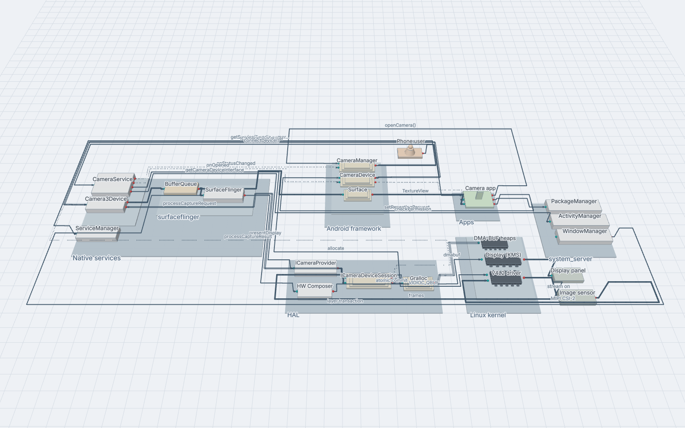

# Archi3D

Archi3D turns a short text description of a software system — its components, their interfaces
(ports) and the links between them — into a 3D view you can orbit, zoom into and click through.
Containers are stacked as levels, so the nesting is visible at a glance.



```
system Shop {
  container Backend {
    service Orders    in: api      out: db, pay
    database OrderDB  in: db
  }
}
external Payments   in: charge

Orders.db  -> OrderDB.db
Orders.pay -> Payments.charge : HTTPS
```

## What you can do

- **Edit and explore** in the browser app: live 3D view, errors underlined as you type,
  click to select, double-click to fly in, semantic zoom for large models.
- **Import** Mermaid `architecture-beta` and D2 files.
- **Share** a model as one offline HTML file (`npm run export`).
- **Render PNGs** from the command line (`npm run render -- model.arch`).
- **Preview in VS Code** with the extension in [`vscode/`](vscode).

## Quick start

Node.js 20 or newer:

```sh
npm ci
npm run dev                        # http://localhost:5173
npm run dev -- my-system.arch      # edit your own file; Save writes it back
```

## Documentation

- [User guide](docs/USER_GUIDE.md) — the app, the `.arch` language, examples (incl. an Android app
  and the AOSP camera stack), import, export, every script, WSL, VS Code.
- [Deployment](docs/DEPLOY.md) — hosting it on a web domain.
- [Grammar](docs/GRAMMAR.md) and [architecture](docs/ARCHITECTURE.md).
- [Build plan](docs/PLAN.md) — how it was built, step by step.
- Contributing (people and agents): [AGENTS.md](AGENTS.md) and [CLAUDE.md](CLAUDE.md).

## Tests

```sh
npm test                               # unit tests
npm run lint                           # ESLint + TypeScript
PW_CHANNEL=chrome npm run test:visual  # screenshot tests (installed Chrome)
```

## License

[MIT](LICENSE). Bundled libraries keep their own licences (MIT, EPL-2.0 for ELK,
MPL-2.0 for D2, SIL OFL-1.1 for the Inter font).
