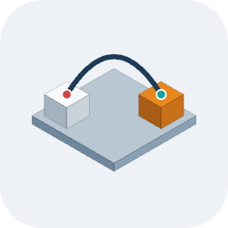

<p align="center">
  
</p>

<h1 align="center">Archi3D</h1>

<p align="center">See your software architecture in 3D.</p>

<p align="center">
  <a href="https://marketplace.visualstudio.com/items?itemName=M-H-H.archi3d"></a>
  <a href="LICENSE"></a>
</p>

You describe your system in a small text file: elements, their ports and the links between
them. Archi3D shows it in 3D. Containers are drawn as levels on top of each other, so you can see
the nesting. You can rotate, zoom in and click on things.


A model looks like this:

```
user User "Shopper"
system Shop {
  app Mobile "Shop app"
  container Backend {
    service Orders    in: api      out: db, pay
    database OrderDB  in: db
    topic Events "Order events"
  }
}
external Payments   in: charge

User       -> Mobile : tap
Mobile    <=> Orders.api : WebSocket
Orders.db  -> OrderDB.db
Orders.pay -> Payments.charge : HTTPS
Orders     ~> Events : OrderPlaced
```

The keyword (`user`, `app`, `service`, `database`, `topic`...) picks the shape, and the arrow picks
how the link looks: `->` call, `=>` message, `~>` event, `<=>` session, `>>` stream, `<>` shared.
The same short list works for Android, AOSP and Linux. The [user guide](docs/USER_GUIDE.md#2-your-first-model) builds a first model with you in five steps.

## Features

- Edit the model in the browser and see the 3D view update while you type. Errors are underlined.
- Click to select, double click to fly in. Containers open as soon as what is inside is readable,
  so you keep the big picture while you zoom.
- Put systems on layers (floors) with `layer` blocks: apps on top, the kernel at the bottom.
- Your own colours (`[color: #2e7d6b]`, `style kind driver [color: slate]`), or colour by layer,
  container or tag with one button.
- Hide the editor (button or key `E`) to give the 3D view the whole window.
- Import Mermaid `architecture-beta` and D2 files.
- Export one HTML file that works offline (`npm run export`).
- Render a PNG from the command line (`npm run render -- model.arch3d`).
- [VS Code extension](https://marketplace.visualstudio.com/items?itemName=M-H-H.archi3d) with a live preview.

## Getting started

You need Node.js 20 or newer.

```sh
npm ci
npm run dev                          # open http://localhost:5173
npm run dev -- my-system.arch3d      # open your own file, Save writes it back
```

## VS Code extension

The extension is on the Marketplace:
**[Archi3D for VS Code](https://marketplace.visualstudio.com/items?itemName=M-H-H.archi3d)**.

It shows the 3D preview next to your `.arch3d` file, shows the errors while you type and can save
the view as PNG or as an offline HTML file. To install, search for "Archi3D" in the Extensions view
of VS Code, or run:

```sh
code --install-extension M-H-H.archi3d
```

You can also take the `.vsix` (version 0.3.0) from
[Releases](https://github.com/Heydarchi/Archi3D/releases) and run
`code --install-extension archi3d-0.3.0.vsix`. More in [vscode/README.md](vscode/README.md).

## Docs

- [User guide](docs/USER_GUIDE.md): start in VS Code, your first model in five steps, the view,
  modelling tips, examples (an Android app, the AOSP camera stack, a Linux desktop), sharing and
  exporting, the web app and WSL.
- [Deployment](docs/DEPLOY.md): put it on your own domain.
- [Language reference](docs/GRAMMAR.md), [all keywords on one page](docs/KEYWORDS.md) and
  [architecture](docs/ARCHITECTURE.md).
- [Working on Archi3D](docs/DEVELOPING.md): setup, tests, scripts, URL parameters, the extension.
- [Build plan](docs/PLAN.md): the steps I followed to build it.
- Rules for contributors and AI agents: [AGENTS.md](AGENTS.md) and [CLAUDE.md](CLAUDE.md).

## Tests

```sh
npm test                               # unit tests
npm run lint                           # ESLint and TypeScript
PW_CHANNEL=chrome npm run test:visual  # screenshot tests with your installed Chrome
```

## License

[MIT](LICENSE). The bundled libraries have their own licenses (MIT, EPL-2.0 for ELK, MPL-2.0 for
D2, SIL OFL-1.1 for the Inter font). See [THIRD_PARTY_NOTICES.md](THIRD_PARTY_NOTICES.md).
