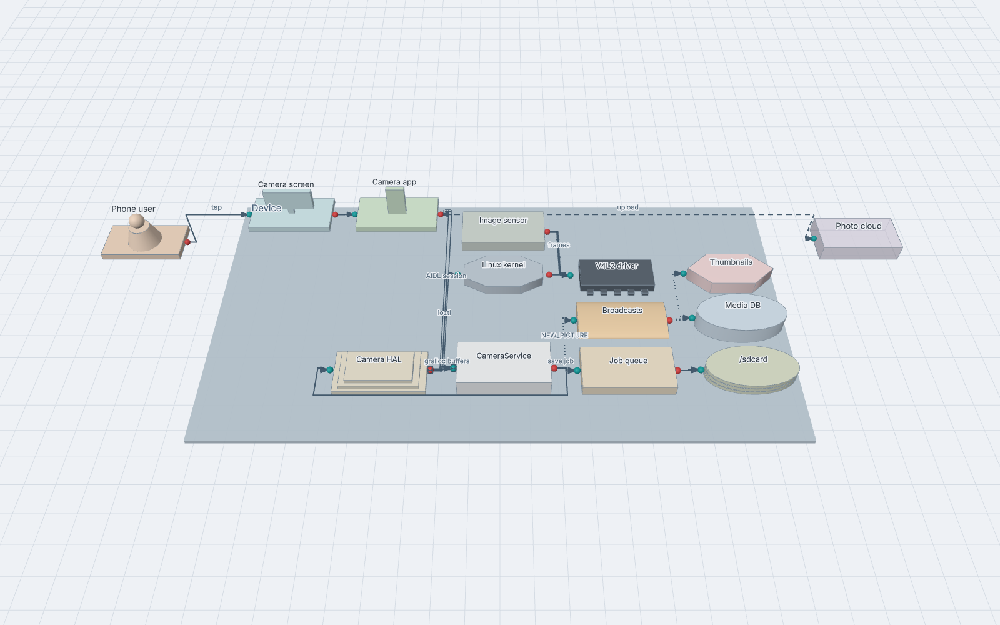
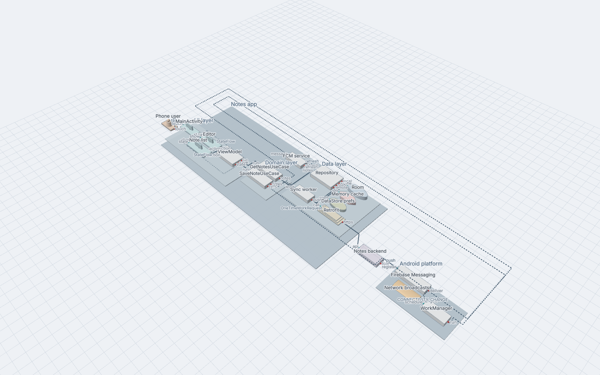
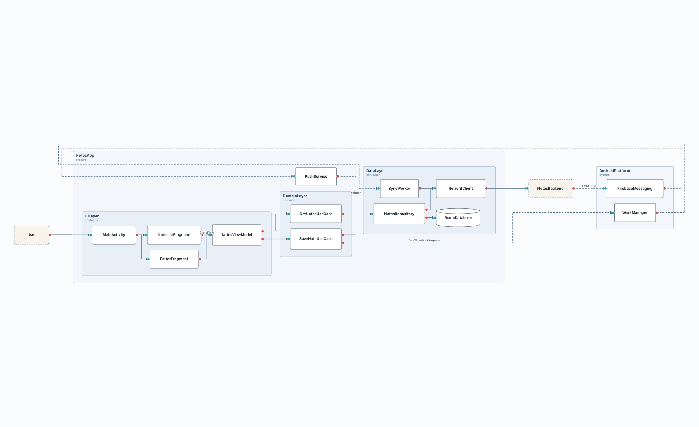
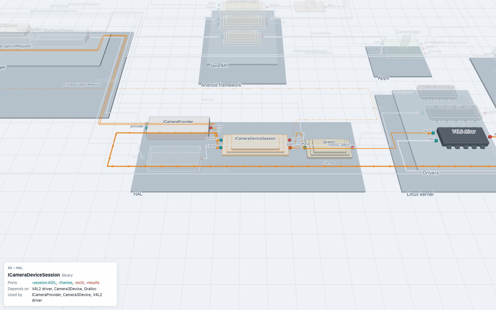
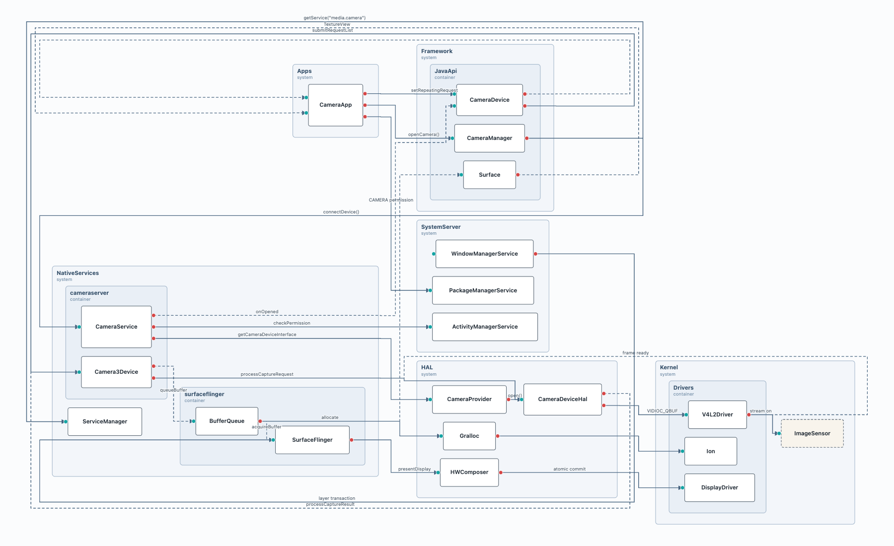
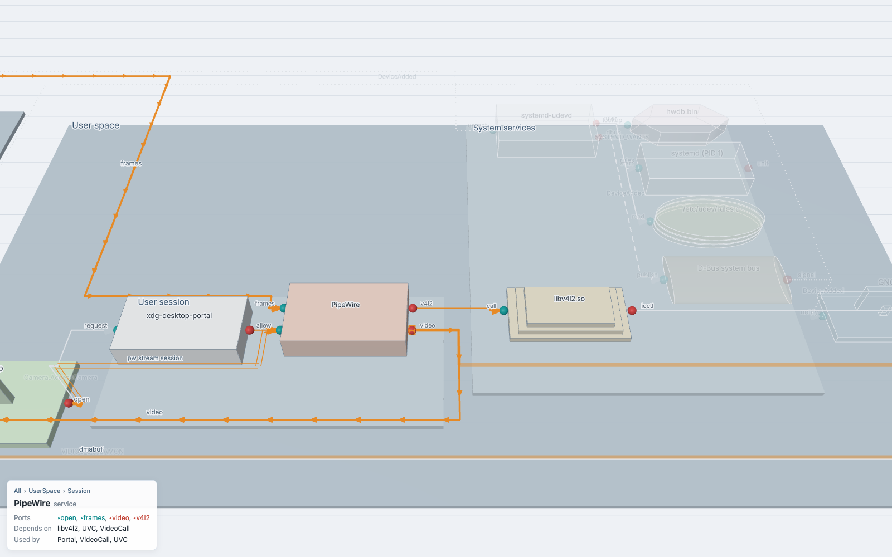
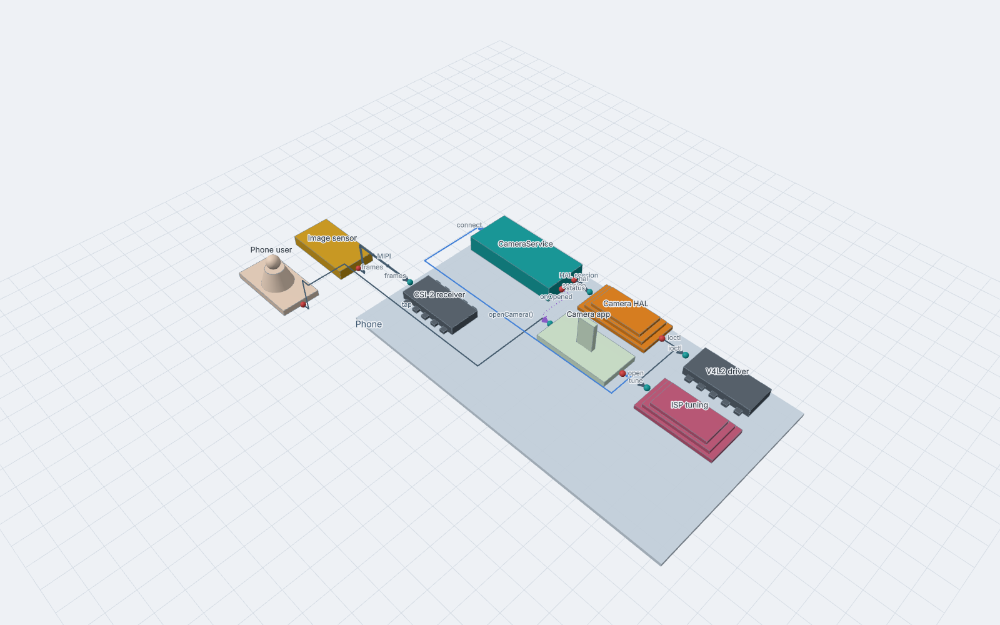
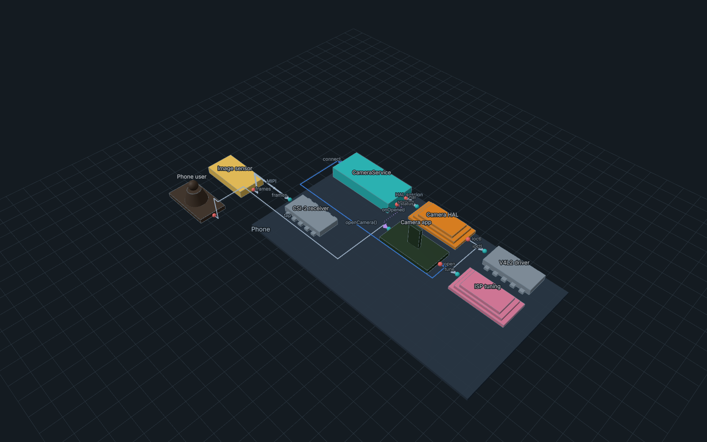
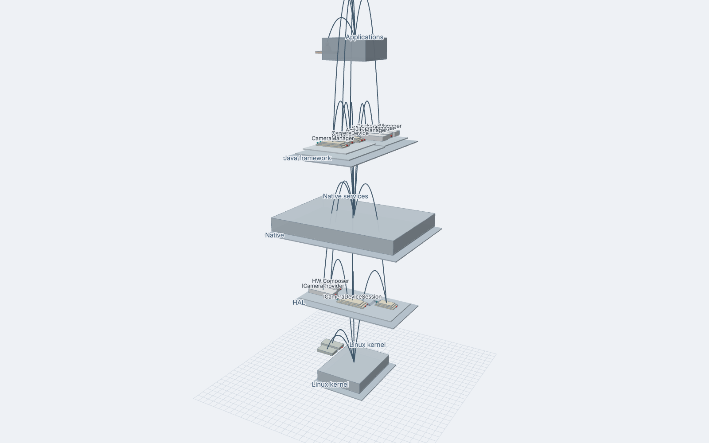
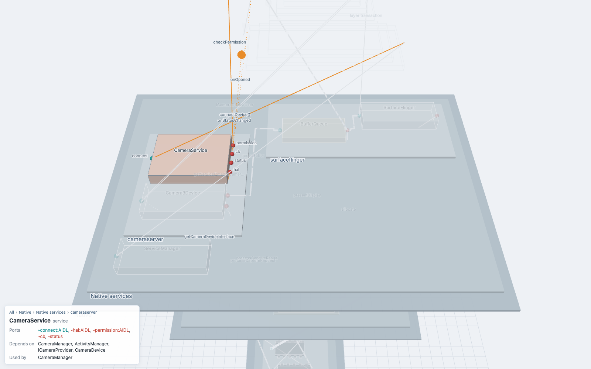

# Archi3D user guide

With Archi3D you write your system in a small text file: components, their ports (interfaces)
and the links between them. Archi3D shows it as a 3D view that you can rotate, zoom and click.
Containers (systems, domains, groups...) are drawn as levels on top of each other, so you can see
how things are nested.

- [1. Getting started](#1-getting-started)
- [2. The app](#2-the-app)
- [3. The language](#3-the-language)
- [4. Examples](#4-examples)
- [5. Import Mermaid and D2](#5-import-mermaid-and-d2)
- [6. One offline HTML file](#6-one-offline-html-file)
- [7. Scripts](#7-scripts)
- [8. URL parameters](#8-url-parameters)
- [9. Windows (WSL / Ubuntu)](#9-windows-wsl--ubuntu)
- [10. VS Code extension](#10-vs-code-extension)
- [11. Problems and fixes](#11-problems-and-fixes)

---

## 1. Getting started

You need Node.js 20 or newer. In the project folder:

```sh
npm ci                     # without internet: npm ci --offline --cache offline/npm-cache
npm run dev                # then open http://localhost:5173
```

The app starts with an example model (`northwind`). Change the text on the left, the 3D view on
the right updates about 0.3 seconds after you stop typing.

To work on your own file, give it to `npm run dev`:

```sh
npm run dev -- my-system.arch3d      # opens it in the editor, Save writes it back
```

More about this in [Edit a file on disk](#edit-a-file-on-disk).

To make one file that you can send by email or just double click:

```sh
npm run export -- examples/03-containers.arch3d --out shop.html
```

---

## 2. The app

```
┌───────────── editor ─────────────┬───────────────── 3D view ──────────────────┐
│ northwind.arch3d  Import…  1 err │ [Hide editor] [Bundling] [Semantic zoom] [Edges] │
│  1 # Northwind Shop              │                                             │
│  2 external Customer out: …      │            plates, blocks, links            │
│  …                               │                                             │
│                                  │ ┌ info panel ┐                              │
│                                  │ │ All › Shop │                              │
└──────────────────────────────────┴─┴────────────┴─────────────────────────────┘
```

On small screens (phones) the editor goes to the bottom. To see only the 3D view, click
**Hide editor** or press `E` (when you are not typing in the editor). Click **Show editor** or
press `E` again to get it back. `?editor=0` in the URL opens the app with the editor hidden.

### Editor

| What | How |
|---|---|
| Errors and warnings | Red or yellow underline, move the mouse over it to see the message. The count is on the top right. |
| Undo / redo | `Ctrl+Z` / `Ctrl+Shift+Z` (`Cmd` on Mac) |
| Indent | `Tab` |
| Open another file | Import... (`.arch3d`, Mermaid `.mmd`, D2 `.d2`) |

A mistake doesn't stop the view. Everything that is valid is still drawn while you type.

### Edit a file on disk

```sh
npm run dev -- path/to/my-system.arch3d          # also possible: --port 5174, --host, --open
```

- The editor shows the file. Save (the button, or `Ctrl+S` / `Cmd+S`) writes it back.
  A `●` before the name means you have unsaved changes. If you close the tab, it asks first.
- If the file doesn't exist yet, it starts with a small example and the first save creates it.
- You can change the file somewhere else at the same time (VS Code, vim, `git pull`). When it changes
  on disk, the app loads it again and keeps your camera. If you also have unsaved changes, it asks
  you: use the disk version or keep yours. It never overwrites anything without asking. Saving is
  also refused if the file was changed after you opened it, and you get the same question.
- Mermaid (`.mmd`) or D2 (`.d2`) files are converted to `.arch3d` when they open. Save writes
  `my-system.arch3d` next to them, the original file is not changed.
- Only the file you gave on the command line can be read or written, and only through the dev
  server on your own machine. It listens on `localhost`, unless you add `--host`.

### 3D view

| What | Mouse | Touch |
|---|---|---|
| Rotate | drag with the left button | one finger |
| Move | drag with the right button | two fingers |
| Zoom (to the mouse position) | scroll wheel | pinch |
| Select | click on a block or plate | tap |
| Fly in | double click | double tap |
| Go back | click All (or a parent) in the breadcrumb of the info panel | |
| Clear the selection | click on the empty ground | |
| Open a closed container where it is | click on it (it stays open while it is selected) | tap |
| More or less detail at the same distance | `+` and `-`, `0` back to normal | |

What you see:

- Plates are containers. Every nesting level is one floor higher.
- Blocks are elements. The keyword decides the shape: a person for `user`, a screen for `ui`, a
  phone for `app`, a cylinder for `database` and so on (see [the language](#3-the-language)).
- Ports: teal is provided (`in`), red is required (`out`).
- Links: the line shows how the two sides talk. Solid is a call, dashed a message, dotted an
  event, two thin lines a session, a thick line with marks a stream, a wide band a shared buffer.
  The arrow is at the target.



When you select something, it and its direct links become orange and the rest fades out. For a
container, the links that cross its border are shown. The info panel shows the kind, the ports,
what it depends on and what uses it.

Buttons on the top right:

| Button | What it does |
|---|---|
| Semantic zoom: on/off | On: from far away the containers close (you see a box) and the links inside them are drawn as one arc between two containers. A container opens as soon as what is inside it is big enough to read, the biggest ones first, so the screen doesn't get too full. Port and link labels only show when there is enough space. Off: everything open. |
| Edges: ortho/arc | Links with right angles, or as arcs. |
| Hide editor / Show editor | The 3D view takes the whole window. Key `E` does the same. |
| Colour: kind/layer/container/tag | Kind is the normal look with your own colours. Layer, container and tag colour every element by its group and show a small legend. |
| Bundling: off/on | Links between closed containers follow the nesting tree and are bundled together (hierarchical edge bundling). Links of the selected element are not bundled. |

---

## 3. The language

One statement per line. `#` or `//` starts a comment. The full reference is in
[GRAMMAR.md](GRAMMAR.md), all keywords on one page are in [KEYWORDS.md](KEYWORDS.md).

The files use the extension `.arch3d`. I picked this name because no other tool uses it, so editors
don't confuse it with something else. Old files with `.arch` still work in the app and the command
line tools, but the VS Code extension only knows `.arch3d`. To rename: `git mv model.arch model.arch3d`.

### Components

```
kind Name ["Title"] [in: port, port…] [out: port, port…]
```

- `kind` only decides the shape. The list is short on purpose and works for Android, AOSP and
  Linux:

  | Keyword | Shape | For example |
  |---|---|---|
  | `user` | a person | the phone user, a user at the shell |
  | `ui` | a screen | an Activity, SystemUI, a GTK window |
  | `app` | a phone | an APK, a system app, a desktop app |
  | `service` | a box | a Service, a system_server service, a daemon |
  | `library` | stacked layers | an AAR, a HAL implementation, a `.so` |
  | `driver` | a chip | a kernel driver |
  | `kernel` | a flat octagon | the Linux kernel, the binder driver |
  | `device` | a box on feet | a sensor, a modem, a USB device |
  | `database` (`db`) | a cylinder | Room, SQLite, PostgreSQL |
  | `cache` | a hexagon | LruCache, Redis |
  | `storage` | stacked disks | files, `/sdcard`, a file system |
  | `queue` | a low box | a Handler queue, a message queue |
  | `topic` | a pipe | broadcasts, D-Bus signals |
  | `external` | a see-through box | a backend, a remote host |

  Any other word (`component`, `system`, `container`...) is a plain box. `actor` still works
  and is the same as `user`.
- `Name`: letters, numbers, `_` and `-`. It must be unique in the file.
- `"Title"` (optional) is shown as the label instead of the name, so the name can stay short:
  `driver V4L2 "V4L2 camera driver"`. Links still use the name.
- `in` ports are what the component provides (drawn on the left side), `out` ports are what it
  needs (right side).
- A port can have a type: `in: orders:REST`.

### Containers

```
system Shop {          # any word as kind, "{" at the end opens the container
  service Orders
  container Backend {  # containers can be nested
    database OrderDB
  }
}                      # "}" closes the last opened one
```

### Links

```
From[.port] -> To[.port] [: label]       # a call
From[.port] => To[.port] [: label]       # a message
From[.port] ~> To, Other [: label]       # an event to two listeners
From[.port] session To[.port] [: label]  # the same as <=>, words work too
From[.port] <- To[.port] [: label]       # same as To -> From
```

There are six kinds. Pick by how the two sides talk:

| Arrow | Word | When | Looks like |
|---|---|---|---|
| `->` | `call` | ask and wait for the answer (method call, AIDL call, syscall, `ioctl`) | solid line |
| `=>` | `message` | send and don't wait, one receiver (explicit Intent, `oneway` AIDL, message queue) | dashed line |
| `~>` | `event` | tell anyone who listens (broadcast, callback, Flow, signal, uevent) | dotted line |
| `<=>` | `session` | a connection that stays open both ways (bound service, HAL session, socket) | two thin lines, arrows at both ends |
| `>>` | `stream` | data that keeps flowing (camera frames, audio, a pipe) | thick line with marks |
| `<>` | `shared` | both use the same memory or data (gralloc buffers, ashmem, `mmap`) | wide band, squares at the ends |

The full table with the Android, AOSP and Linux mapping is in [GRAMMAR.md](GRAMMAR.md#link-kinds).

- If you leave out the port, the first port with the right direction is used. If there is none,
  a port without a name is created.
- If you use a port in a link that is not declared, it is created for you.
- Several targets with commas: `Bus ~> Mail, Sync : BOOT` is two links with the same kind and label.
- Links can go to containers too: `Frontend -> Backend : REST`.
- Links use names, not paths: `OrderDB`, not `Shop.Backend.OrderDB`.

### Colours

Give an element, a container or a link its own colour, or colour many at once:

```
driver V4L2 "V4L2 driver" [color: #2e7d6b]
system Phone [color: #dbe9f6, dark: #2a3d52] { ... }   # a container gets a tinted plate
Camera -> CameraService [color: #3a7bd5] : openCamera()

style kind driver   [color: slate]      # every driver
style tag vendor    [color: #e8871e]    # everything with [tag: vendor]
style link event    [color: purple]     # every event link
```

- `#rrggbb` (or `#rgb`) is used exactly as written, in the light and in the dark theme. If you want
  another colour for the dark theme, add `dark: #…`.
- Names are shortcuts that change with the theme: red, orange, amber, green, teal, blue, indigo,
  purple, pink, brown, slate, gray.
- `[tag: vendor]` gives an element a tag. You can have more than one.
- The element's own colour wins over a `style tag`, and that wins over a `style kind`.
- Inside `[ ]` the `#` is part of the colour, so `# comments` still work after the `]`.
- When something is selected it gets a bit lighter and an orange outline, so it never clashes with
  your colours.

The **Colour** button (top right) colours by layer, by top container or by tag, without changing
the file, and shows a legend.

### Layers

Put your systems on floors with `layer` blocks. The first layer you write is the top floor:

```
layer Apps "Applications" {
  system Apps { ... }
}
layer Framework "Java framework" {
  system Framework { ... }
  system SystemServer { ... }
}
layer Kernel "Linux kernel" {
  system Kernel { ... }
}
```

- Change the order by moving the blocks. Your systems stay as they are, a layer just holds them.
- Links between floors go straight up or down.
- Elements outside every layer (a `user`, a `device`) stand next to the floor they link to most.
- A model with layers opens with a low camera from the side, so you see the whole stack.
- When you come close to one floor, the floors above it turn into faint outlines so they don't
  cover it, and only the labels of that floor are shown.

### Messages

| Code | Meaning |
|---|---|
| E001 | The line is not a valid statement (typo, a wrong character) |
| E002 | `}` but no container is open |
| E003 | A container is never closed (shown on the line where it starts) |
| E101 | A name is defined twice |
| E102 | A link uses a name that doesn't exist |
| E103 | A component links to itself |
| W201 | Both ports have a type and the types are different |
| W202 | An `in` port is used as link source, or an `out` port as target |
| W203 | A `layer` is inside a container or has no `{ }`, so it is not a floor |
| W204 | Unknown attribute in `[ ]`, or a value that is not a colour |
| W301 | (Import) a Mermaid line that is not supported was skipped |

---

## 4. Examples

All of them are in [`examples/`](../examples). The unit tests check that they have no errors.

Hello: [`examples/01-hello.arch3d`](../examples/01-hello.arch3d)

```
ui       Web
service  Api
database Store

Web -> Api : HTTPS
Api -> Store
```

Ports and types: [`examples/02-ports.arch3d`](../examples/02-ports.arch3d)

```
ui      Web       out: api:REST
service Api       in: api:REST, admin   out: db:SQL, events
database Store    in: db:SQL
queue   Events    in: publish   out: deliver
service Mailer    in: send

Web.api     -> Api.api
Api.db      -> Store.db
Api.events  => Events.publish : UserSignedUp   # asynchronous
Events.deliver => Mailer.send
```

Nesting: [`examples/03-containers.arch3d`](../examples/03-containers.arch3d)

```
external Customer   out: browse

system Shop {
  container Frontend {
    ui Web            in: browse   out: api
  }
  container Backend {
    service Orders    in: api      out: db, pay
    database OrderDB  in: db
  }
}

external Payments   in: charge

Customer.browse -> Web.browse
Web.api         -> Orders.api   : REST
Orders.db       -> OrderDB.db
Orders.pay      -> Payments.charge
```

Links to containers and the reverse arrow: [`examples/04-container-links.arch3d`](../examples/04-container-links.arch3d)

```
container Mobile   { … }
container Platform { … }
Mobile -> Platform : HTTPS
App <- Push : notifications     # means Push -> App
```

### Android app

[`examples/06-android-app.arch3d`](../examples/06-android-app.arch3d): the UI layer (Activity,
Fragments, ViewModel), then the use cases, then the data layer (Repository, Room, a memory cache,
DataStore, Retrofit, a WorkManager sync worker, an FCM push service), plus the platform and the
backend. The ViewModel's `StateFlow` is an event to both fragments, WorkManager jobs and push
messages are messages, the network change is an event from a broadcast topic.

```
user User "Phone user"          out: touch

app NotesApp "Notes app" {
  container UiLayer "UI layer" {
    ui MainActivity             in: touch          out: nav
    ui NoteListFragment "Note list"  in: show, state   out: action
    …
  }
  container DataLayer "Data layer" {
    database RoomDatabase "Room"     in: dao:SQL
    cache    NotesCache   "Memory cache"  in: get
    library  RetrofitClient "Retrofit"    in: call   out: https:REST
    …
  }
}
MainActivity.nav       -> NoteListFragment.show, EditorFragment.show
NotesViewModel.state   ~> NoteListFragment.state, EditorFragment.state : StateFlow
SaveNoteUseCase.sync   => WorkManager.schedule : OneTimeWorkRequest
Connectivity.changed   ~> WorkManager.schedule : CONNECTIVITY_CHANGE
```

| 3D | 2D |
|---|---|
|  |  |

### AOSP camera stack

[`examples/07-aosp-camera.arch3d`](../examples/07-aosp-camera.arch3d) follows one camera preview
through the whole platform. The app calls `CameraManager` in the framework. Binder sends
`connectDevice()` to `CameraService` in the native `cameraserver` process. Before that there is a
lookup in `ServiceManager` and a permission check in `system_server`. The open camera is a
session (`ICameraDeviceUser`), and so is the HAL device session. The HAL talks to the V4L2
driver, the sensor streams frames over MIPI. Frames go through `BufferQueue` to the `Surface` of
the app as streams, the gralloc and dmabuf buffers are shared, and `SurfaceFlinger` puts them on
the screen with `HWComposer` and the display driver. Callbacks like `onOpened` are events.

```
library CameraManager        in: open, status       out: binder:AIDL
service CameraService        in: connect:AIDL       out: hal:AIDL, permission:AIDL, cb, status
library CameraDeviceHal "ICameraDeviceSession"  in: session:AIDL, frames   out: ioctl, results
driver  V4L2Driver "V4L2 driver"     in: ioctl, mipi    out: frames
…
CameraManager.binder     -> CameraService.connect      : connectDevice()
CameraService.cb         ~> CameraDevice.cb            : onOpened
CameraDevice.binder     <=> Camera3Device.submit       : ICameraDeviceUser
ImageSensor.mipi         >> V4L2Driver.mipi            : MIPI CSI-2
CameraDeviceHal          <> Gralloc                    : gralloc buffers
```

| The whole stack from far (one arc between two layers) | The HAL from close, `CameraDeviceHal` selected |
|---|---|
|  |  |

All the links in 2D: 

### Linux desktop

[`examples/08-linux-desktop.arch3d`](../examples/08-linux-desktop.arch3d): a USB webcam is
plugged in and used in a video call. The kernel sends a uevent, `systemd-udevd` reads its rules
and the hwdb, D-Bus tells the app and the shell (an event to two listeners), the app asks
`xdg-desktop-portal` and opens a PipeWire stream (a session). PipeWire reads the frames from the
`uvcvideo` driver through `libv4l2` and shares dmabuf buffers with it.

```
DBus.signal         ~> VideoCall.added, Panel.notify : DeviceAdded
VideoCall          <=> PipeWire : pw stream session
UVC.frames          >> PipeWire.frames : frames
PipeWire            <> UVC : dmabuf
```



### Colours

[`examples/11-colours.arch3d`](../examples/11-colours.arch3d) uses all three ways: own colours,
`style kind`, `style tag` and `style link`.

| Light | Dark |
|---|---|
|  |  |

### AOSP camera stack on layers

[`examples/10-aosp-layers.arch3d`](../examples/10-aosp-layers.arch3d) is the same model as the AOSP
example, with its systems on five layers: applications, Java framework, native, HAL and the Linux
kernel.

| The stack | Close to the native floor, CameraService selected |
|---|---|
|  |  |

### Legend

[`examples/09-legend.arch3d`](../examples/09-legend.arch3d) has every keyword and every link kind
once. Copy from it when you forget a shape.


I made these pictures with the render command (section 7):

```sh
npm run render -- examples/06-android-app.arch3d
npm run render -- examples/07-aosp-camera.arch3d --cam far --lod on
npm run render -- examples/07-aosp-camera.arch3d --out examples/07-aosp-camera-hal.png --focus HAL --k 1.8 --select CameraDeviceHal --panel
npm run render -- examples/07-aosp-camera.arch3d --view svg2d --out examples/07-aosp-camera-2d.png --width 1800 --height 1100
npm run render -- examples/08-linux-desktop.arch3d --focus UserSpace --k 0.75 --select PipeWire --panel
npm run render -- examples/09-legend.arch3d --focus Device --k 1.35
npm run render -- examples/10-aosp-layers.arch3d --cam far --lod on
npm run render -- examples/11-colours.arch3d --cam iso
npm run render -- examples/11-colours.arch3d --cam iso --theme dark --out examples/11-colours-dark.png
npm run render -- examples/10-aosp-layers.arch3d --focus NativeLayer --k 1.1 --lod on --select CameraService --panel --out examples/10-aosp-layers-native.png
```

Bigger models: [`fixtures/northwind.arch3d`](../fixtures/northwind.arch3d) (a web shop),
[`fixtures/nested-deep.arch3d`](../fixtures/nested-deep.arch3d) (four levels) and
`fixtures/gen-1000.arch3d` (1000 generated components, open the app with `?fixture=gen-1000`).

---

## 5. Import Mermaid and D2

Click Import... and pick a file. The format comes from the extension (`.arch3d`, `.mmd`/`.mermaid`,
`.d2`). For other names it looks at the first line (`architecture-beta`). The file is converted to
`.arch3d` text in the editor, so you can continue editing it.

Mermaid `architecture-beta` ([`examples/05-mermaid.mmd`](../examples/05-mermaid.mmd)):

```
architecture-beta
    group shop(cloud)[Shop]
    service web(internet)[Web] in shop
    service api(server)[API] in shop
    service db(database)[Database] in shop
    web:R --> L:api
    api:R --> L:db
```

- `group` becomes a container and `service` a component. The icon decides the kind:
  `database`/`disk` is a database, `internet` an external, `server`/`cloud` a service.
- The sides of a link (`L R T B`) become ports on that side. `--`, `-->`, `<--` and `<-->` work.
- `junction`, `title` and other lines are skipped with a W301 warning.

D2 ([`fixtures/adapters/northwind.d2`](../fixtures/adapters/northwind.d2)): nested objects
become containers. `shape: cylinder` is a database, `queue` a queue and `person` an actor. Dashed
connections (`style.stroke-dash`) become asynchronous links. The D2 compiler is big (about 8 MB),
so it is only loaded when you import a `.d2` file. It is not in the offline HTML file.

---

## 6. One offline HTML file

```sh
npm run export -- my-model.arch3d --out my-model.html
```

`my-model.html` has everything inside (about 2.6 MB): the app, the layout engine, the font and your
model. It doesn't need a server or internet. You can double click it, send it by email or put it on
a USB stick. People can also edit the model in it, but the changes are not saved to the file.

- Only `.arch3d` models can go inside. For Mermaid or D2, import them in the app first and copy the text.
- `--cdn` makes a version that tries to load the layout engine from a CDN first (3 seconds timeout)
  and uses the built in copy if that fails. It is not smaller. It is only for places that prefer
  libraries from a CDN.

---

## 7. Scripts

Run them in the project folder. Put arguments after `--`.

| Command | What it does |
|---|---|
| `npm run dev -- [model.arch3d\|.mmd\|.d2] [--port 5173] [--host] [--open]` | The app on http://localhost:5173. With a file you can edit it in the app and save it back ([more](#edit-a-file-on-disk)). |
| `npm run build` | Production build in `dist/` (static files, see [DEPLOY.md](DEPLOY.md)) |
| `npm run preview` | Serve the production build on http://localhost:4173 |
| `npm run export -- [model.arch3d] [--cdn] [--out file.html]` | One offline HTML file. Default model `fixtures/northwind.arch3d`, default output `dist/archi3d-standalone.html` (`…-cdn.html` with `--cdn`) |
| `npm run render -- <model> [options]` | Make a PNG of a model (`.arch3d`, `.mmd`, `.d2`) with headless Chrome. Options: `--out file.png`, `--view scene\|svg2d`, `--cam far\|mid\|near\|iso` (default iso), `--focus <Id> --k <n>`, `--width 1600 --height 1000 --scale 1`, `--edges ortho\|arc`, `--lod off\|on` (default off, everything open), `--bundle`, `--select <Id>` (and `--panel` to show the info panel), `--theme light\|dark`, `--browser chromium\|chrome\|msedge`. If the sources changed it builds the app first. |
| `npm run generate -- [components] [seed]` | Make a random test model `fixtures/gen-<components>.arch3d` (default 1000 and 42). The same seed gives always the same model. |
| `npm test` | Unit tests (Vitest, Node) |
| `npm run lint` | ESLint (also the rule that core must not import three.js) and TypeScript |
| `npm run test:visual` | Build, export, then the screenshot tests (Playwright). Use `PW_CHANNEL=chrome` (or `msedge`) for your installed browser. The pictures to check are in `artifacts/step-N/`. |
| `npm run test:visual:update` | Same, but takes the new pictures as reference. Only do this after you checked them. |
| `npm run vscode:build` / `npm run vscode:package` | Build the VS Code extension in `vscode/dist/` / also make `vscode/archi3d-<version>.vsix` (section 10) |
| `npm run vscode:publish -- --publisher <id>` | Checks, packages and publishes the extension ([RELEASE.md](RELEASE.md)) |
| `npm run test:vscode` | Runs the extension in a real VS Code with a temporary profile (VS Code must be installed, `VSCODE_BIN` can point to it) |
| `npm run icon` | Makes `vscode/icon.png` again from the icon design |
| `npm run notices` | Writes the third party license files again (after changing dependencies) |
| `npm run vendor` | Copies the pinned libraries and fonts to `vendor/` with SHA-256 hashes |
| `npm run offline:pack` | Fills `offline/npm-cache` so `npm ci --offline --cache offline/npm-cache` works without internet |

---

## 8. URL parameters

App (`index.html`, or the root of the dev server):

| Parameter | What it does |
|---|---|
| `fixture=<name>` | Start with one of the bundled models: `northwind`, `nested-deep`, `tiny`, `gen-1000`, ... |
| `editor=0` | Start with the editor hidden, only the 3D view |
| `test=1` | Test mode (no animation, `window.__archi` for the tests) |

Harness (`harness.html`, one view per page, useful for screenshots and debugging):

| Parameter | Values |
|---|---|
| `view` | `parse` (source and syntax tree), `model` (tables), `svg2d` (2D layout), `proj` (top and side view), `scene` (3D) |
| `fixture` | like above, and also `errors/bad-line`, `adapters/northwind.mmd`, `adapters/northwind.d2` |
| `cam` | `far`, `mid`, `near`, `iso`, or `focus` with `focus=<id>&k=<distance in footprint diagonals>` |
| `edges` | `ortho`, `arc` |
| `gap` | space between levels (default 60) |
| `lod=off`, `bundle=on`, `select=<id>`, `theme=dark`, `font=<url>` | what the name says |
| `colorby=layer`, `container` or `tag` | colour by group, with the legend |
| `zoom=size`, `detail=1.5` | the first zoom rule; more or less detail |

Example: `http://localhost:5173/harness.html?view=scene&fixture=nested-deep&cam=iso&edges=arc`

---

## 9. Windows (WSL / Ubuntu)

Archi3D works in WSL (Ubuntu on Windows) like on any Linux. You can use your normal Windows browser.

```sh
# inside Ubuntu (WSL)
sudo apt update && sudo apt install -y curl
curl -fsSL https://deb.nodesource.com/setup_22.x | sudo -E bash -
sudo apt install -y nodejs
cd ~/archi3d            # keep the project in the Linux file system, not in /mnt/c (much faster)
npm ci
npm run dev             # open http://localhost:5173 in Windows, WSL forwards localhost
```

As a render tool, to make PNG pictures from the command line (install the headless browser once:
`npx playwright install --with-deps chromium`):

```sh
npm run render -- ~/models/payments.arch3d --out ~/models/payments.png --cam iso
npm run render -- ~/models/payments.arch3d --view svg2d --theme dark
explorer.exe "$(wslpath -w ~/models/payments.png)"
```

Or one HTML file that you can open in Windows and click around:

```sh
npm run export -- ~/models/payments.arch3d --out ~/models/payments.html
explorer.exe "$(wslpath -w ~/models/payments.html)"
```

For the screenshot tests in WSL, install Playwright's browser once with
`npx playwright install --with-deps chromium` and run `npm run test:visual` without `PW_CHANNEL`.

---

## 10. VS Code extension

A 3D preview inside VS Code, next to the file you are editing.

Install it from the Marketplace:
[Archi3D for VS Code](https://marketplace.visualstudio.com/items?itemName=M-H-H.archi3d).
In VS Code search for "Archi3D" in the Extensions view, or run:

```sh
code --install-extension M-H-H.archi3d
```

On WSL, run VS Code on Windows with the WSL extension and install Archi3D on the WSL side when it asks.

To try your own build of the extension:

```sh
npm run vscode:package                       # makes vscode/archi3d-0.3.0.vsix
code --install-extension vscode/archi3d-0.3.0.vsix
```

Use:

| What | How |
|---|---|
| Open the preview | Open a `.arch3d` or Mermaid `.mmd` file, then the preview button in the editor title, `Ctrl+K V` (`Cmd+K V`) or "Archi3D: Open 3D Preview to the Side" |
| Live update | Just type. The preview updates after about 0.3 seconds and keeps the camera. When you switch to another model file it frames the new one. |
| Go to the definition | Click a block in the preview, double click to fly in |
| Errors and warnings | In the editor and in the Problems panel (same codes as in section 3) |
| Save a picture | "Archi3D: Save 3D Preview as PNG..." (what you see in the preview, in screen resolution) |
| Share | "Archi3D: Export Standalone HTML...", the same offline file as `npm run export` |
| Buttons in the preview | Semantic zoom, edge style, bundling, Fit |

The preview uses the light or dark theme of VS Code. Everything works offline. Not supported in
VS Code yet: D2 files (use Import in the app), completion and go to definition.

Develop and test the extension:

```sh
npm run vscode:build      # vscode/dist/ (extension, preview, export template)
npm run test:vscode       # opens VS Code with a temporary profile in test-results/,
                          # runs tests/vscode/runner.cjs and saves the preview pictures in artifacts/vscode/
```

To debug: open the `vscode/` folder in VS Code and press `F5` (Run Extension), or run
`code --extensionDevelopmentPath="$PWD/vscode" examples`.

How to publish a new version is in [RELEASE.md](RELEASE.md).

---

## 11. Problems and fixes

| Problem | Fix |
|---|---|
| The labels have a plain font and the console says "using HTML labels" | The label font couldn't be loaded, so it uses HTML labels. Check that `vendor/fonts/` and `assets/` of the build are served. |
| The 3D view is empty | WebGL is off in the browser. Check `chrome://gpu`. On servers or VMs start Chrome with `--use-angle=swiftshader --enable-unsafe-swiftshader`. |
| "Laying out..." takes long | Very big models need a few seconds (1000 components take about 1 second on a laptop). |
| D2 import doesn't work in the offline file | That's expected, the D2 compiler is only in the full app. |
| `npm ci --offline` fails | Run `npm run offline:pack` once while you are online. |
| Visual tests say "Executable doesn't exist" | Set `PW_CHANNEL=chrome` (or `msedge`), or run `npx playwright install chromium`. |
