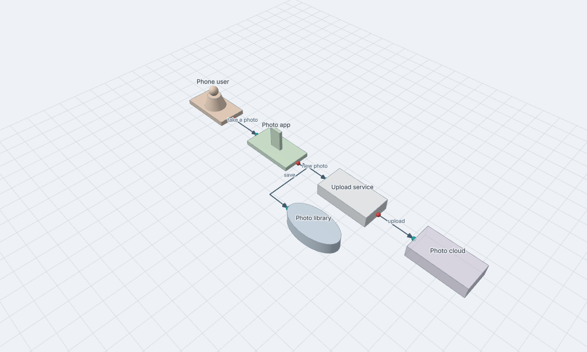
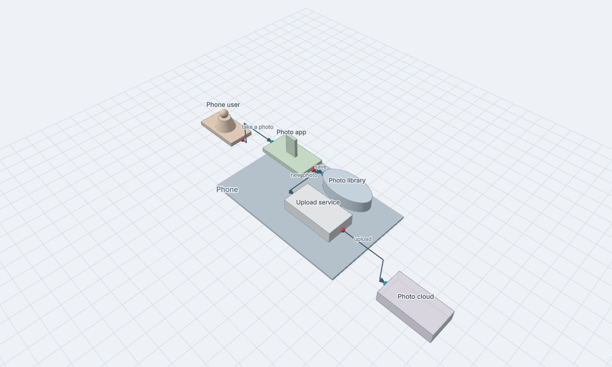
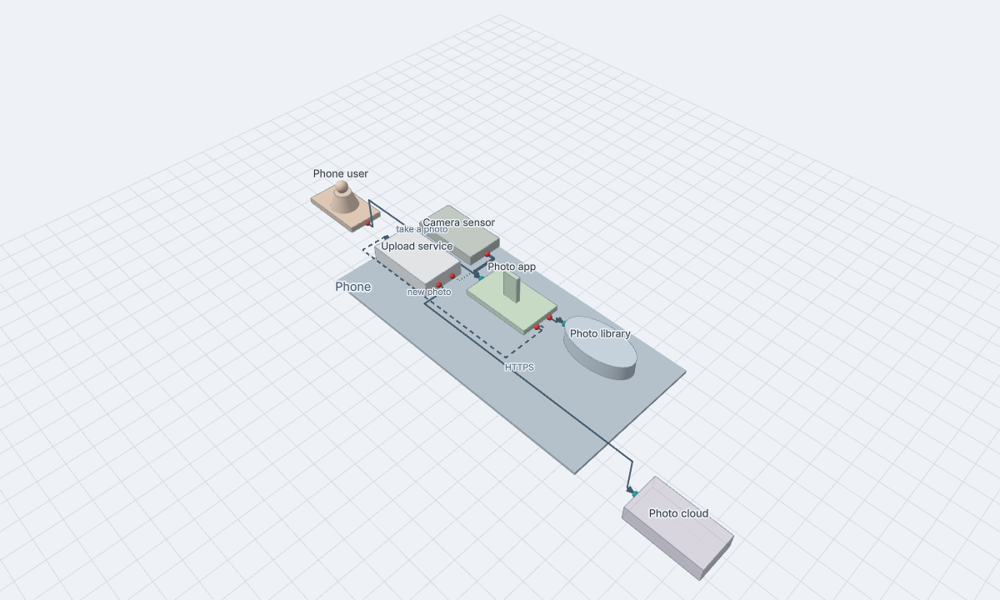
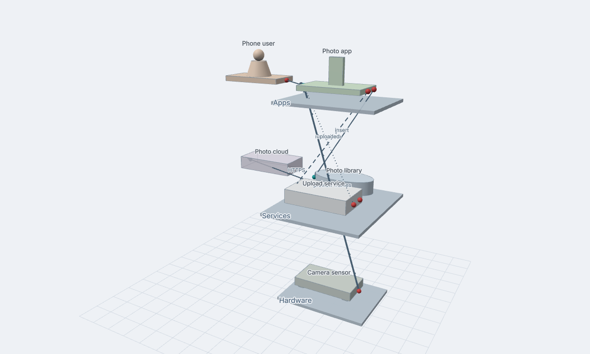
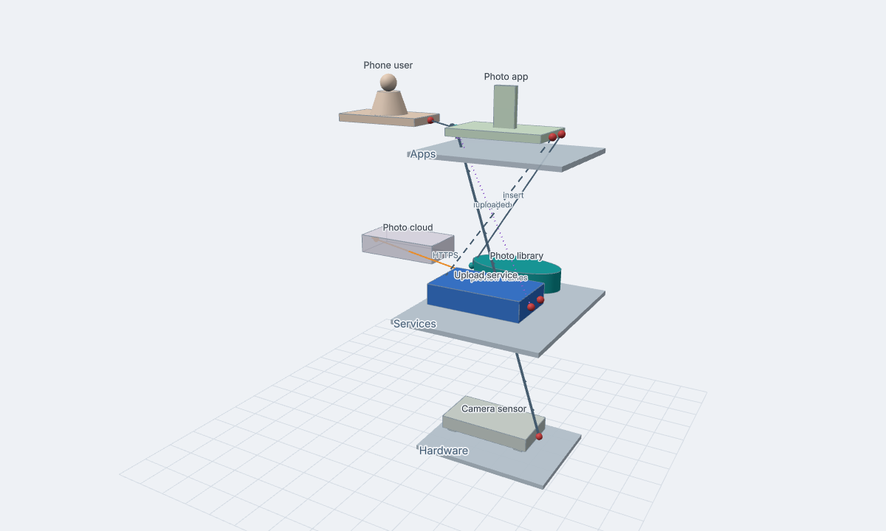

# Archi3D user guide

Archi3D shows your software architecture in 3D. You write a small text file: the elements of your
system, how they are grouped and how they talk to each other. Archi3D draws it, and you can
rotate, zoom in and click on things.


This guide takes you from nothing to your own model:

1. [Start in VS Code](#1-start-in-vs-code) (5 minutes)
2. [Your first model](#2-your-first-model) (5 short steps)
3. [Find your way around the view](#3-find-your-way-around-the-view)
4. [Model your own system](#4-model-your-own-system)
5. [Examples](#5-examples)
6. [Share and export](#6-share-and-export)
7. [Without VS Code](#7-without-vs-code)
8. [Problems and fixes](#8-problems-and-fixes)

Two more pages help while you write: [KEYWORDS.md](KEYWORDS.md) has every keyword on one page, and
[GRAMMAR.md](GRAMMAR.md) is the full reference of the language. If you want to work on Archi3D
itself, see [DEVELOPING.md](DEVELOPING.md).

---

## 1. Start in VS Code

1. **Install the extension.** In VS Code open the Extensions view, search for **Archi3D** and click
   Install. Or in a terminal: `code --install-extension M-H-H.archi3d`.
   ([Marketplace page](https://marketplace.visualstudio.com/items?itemName=M-H-H.archi3d))
2. **Make a file** with the extension `.arch3d`, for example `photos.arch3d`.
3. **Paste this** into it:

   ```
   user     User    "Phone user"
   app      Photos  "Photo app"
   database Library "Photo library"

   User -> Photos : take a photo
   Photos -> Library : save
   ```

4. **Open the preview** with the button in the editor title (top right), with `Ctrl+K V`
   (`Cmd+K V` on Mac), or with **Archi3D: Open 3D Preview to the Side** in the command palette.

You see a person, a phone and a cylinder with two arrows. Change the text and the preview follows
after about 0.3 seconds. That is all you need. The next section builds a real model step by step.

> **Errors?** If you see red lines under new keywords, your VS Code may still run an older version
> of the extension. Check the version in the Extensions view and update it.

---

## 2. Your first model

We build a small photo app in five steps. Each step adds one idea. All five files are in
[`examples/tutorial/`](../examples/tutorial), so you can open them and compare.

### Step 1: elements and links

```
user     User    "Phone user"
app      Photos  "Photo app"
service  Upload  "Upload service"
database Library "Photo library"
external Cloud   "Photo cloud"

User -> Photos : take a photo
Photos -> Library : save
Photos -> Upload : new photo
Upload -> Cloud : upload
```

- One element per line: **kind**, **name**, and optionally a **title** in quotes.
- The kind picks the shape: `user` is a person, `app` a phone, `database` a cylinder, `external`
  a see-through box. Any other word is a plain box.
- The name (`Photos`) is what links use. The title (`"Photo app"`) is what you see. Names must be
  unique in the file.
- `A -> B : text` is a link from A to B, with a label.



### Step 2: group things in a container

```
user User "Phone user"

system Phone {
  app      Photos  "Photo app"
  service  Upload  "Upload service"
  database Library "Photo library"
}

external Cloud "Photo cloud"
```

The links stay the same. A line ending with `{` opens a container, `}` closes it. Containers can
be nested, and each level is drawn one step higher. Any word works as the kind of a container:
`system`, `container`, `group`...



### Step 3: ports and the kind of each link

```
system Phone {
  app      Photos  "Photo app"       in: done   out: save, queue
  service  Upload  "Upload service"  in: job    out: send, status
  database Library "Photo library"   in: save
  device   Camera  "Camera sensor"   out: frames
}
external Cloud "Photo cloud"   in: upload

User -> Photos : take a photo
Camera.frames >> Photos : preview frames
Photos.save -> Library.save : insert
Photos.queue => Upload.job : new photo
Upload.send -> Cloud.upload : HTTPS
Upload.status ~> Photos.done : uploaded
```

- **Ports** are the connection points. `in:` is what an element offers (drawn on the left, teal),
  `out:` is what it needs (on the right, red). `Photos.save` is the port `save` of `Photos`.
  Ports are optional; without them Archi3D makes one for you.
- **The arrow says how the two sides talk.** Each kind has its own line:

| Arrow | Means | Line |
|---|---|---|
| `->` | a call: ask and wait for the answer | solid |
| `=>` | a message: send and don't wait | dashed |
| `~>` | an event: tell anyone who listens | dotted |
| `<=>` | a session: a connection that stays open | two thin lines |
| `>>` | a stream: data that keeps flowing | thick, with marks |
| `<>` | shared memory or data | a wide band |



### Step 4: layers

```
layer Apps "Apps" {
  app      Photos  "Photo app"       in: done   out: save, queue
}
layer Services "Services" {
  service  Upload  "Upload service"  in: job    out: send, status
  database Library "Photo library"   in: save
}
layer Hardware "Hardware" {
  device   Camera  "Camera sensor"   out: frames
}
```

A `layer` is a floor. The first layer you write is on top. Links between floors go up or down.
`User` and `Cloud` are in no layer, so they stand next to the floor they link to. When you look
at one floor from close by, the floors above it fade so they don't cover it.



### Step 5: colours

Two new lines at the top, and two changed lines (the rest of the file stays the same):

```
style kind database [color: teal]
style link event    [color: purple]

service  Upload  "Upload service" [color: #3a7bd5]   in: job    out: send, status

Upload.send -> Cloud.upload [color: #e8871e] : HTTPS
```

- `[color: …]` after a name colours one element (or container, or link).
- `style kind database [...]` colours every database, `style link event [...]` every event link.
- Use `#rrggbb`, or a name like `teal`, `slate` or `purple` that changes with the light and dark
  theme.



That's the whole language: elements, containers, links, layers and colours. The full file is
[`examples/tutorial/5-colours.arch3d`](../examples/tutorial/5-colours.arch3d).

---

## 3. Find your way around the view

### Move around

| What | Mouse | Touch |
|---|---|---|
| Rotate | drag with the left button | one finger |
| Move | drag with the right button | two fingers |
| Zoom (to where the mouse is) | scroll wheel | pinch |
| Select an element or container | click | tap |
| Fly in to it | double click | double tap |
| Go back out | click **All** (or a parent) in the info panel | |
| Clear the selection | click on the empty ground | |
| More or less detail at the same distance | `+` and `-`, `0` back to normal | |

In VS Code, a click also takes the editor to the line where the element is written.

### What you see


- **Plates** are containers, **blocks** are elements. The shape comes from the kind.
- **Ports**: teal is `in`, red is `out`.
- **Links**: the line style is the kind of link (see step 3). The arrow is at the receiver.
- **Closed boxes**: from far away a container closes into a box, and its inside links become one
  arc. It opens again as soon as what is inside is big enough to read, biggest first. Click a
  closed container to open it right away.
- **Selection**: the selected element gets lighter with an orange outline, its direct links turn
  orange and the rest fades. The info panel (bottom left) shows its ports, what it depends on and
  what uses it. For a container, you see the links that cross its border.

### Buttons

On the top right of the view:

| Button | What it does |
|---|---|
| **Hide editor** (web app only) | The 3D view takes the whole window. Key `E` does the same. |
| **Colour: kind** | Click to colour by layer, by top container or by tag instead, with a legend. **kind** is the normal look with your own colours. |
| **Bundling** | Links between closed containers follow the nesting and are bundled together. Good for big models. |
| **Semantic zoom** | On: containers close when they are far away. Off: everything is open. |
| **Edges** | Links with right angles (**ortho**) or as arcs (**arc**). |
| **Fit** (VS Code) | Back to the whole model. |

---

## 4. Model your own system

### Choose the kind of each element

The kind only changes the shape, so pick what reads best. The same short list works for Android
apps, AOSP and Linux:

| Kind | Shape | For example |
|---|---|---|
| `user` | a person | the phone user, a user at the shell |
| `ui` | a screen | an Activity, SystemUI, a GTK window |
| `app` | a phone | an APK, a system app, a desktop app |
| `service` | a box | a Service, a system_server service, a daemon |
| `library` | stacked layers | an AAR, a HAL implementation, a `.so` |
| `driver` | a chip | a kernel driver |
| `kernel` | a flat octagon | the Linux kernel, the binder driver |
| `device` | a box on feet | a sensor, a modem, a USB device |
| `database` | a cylinder | Room, SQLite, PostgreSQL |
| `cache` | a hexagon | LruCache, Redis |
| `storage` | stacked disks | files, `/sdcard`, a file system |
| `queue` | a low box | a Handler queue, a message queue |
| `topic` | a pipe | broadcasts, D-Bus signals |
| `external` | a see-through box | a backend, a remote host |

### Choose the kind of each link

Ask how the two sides talk, not which technology they use:

- Does the sender **wait for an answer**? A call, `->`. (A method call, an AIDL call, `ioctl`.)
- Does it **send and go on**, to one receiver? A message, `=>`. (An explicit Intent, `oneway` AIDL.)
- Does it **tell whoever listens**? An event, `~>`. (A broadcast, a callback, a Flow.)
- Do they **keep a connection open** and talk both ways? A session, `<=>`. (A bound service, a socket.)
- Does **data keep flowing**? A stream, `>>`. (Camera frames, audio.)
- Do they **use the same memory**? Shared, `<>`. (gralloc buffers, ashmem.)

You can also write the word instead of the arrow: `Api event Bus`. More examples per platform are
in [GRAMMAR.md](GRAMMAR.md#link-kinds).

### Tips

- **Short names, clear titles.** Names are for links (`CamSvc`), titles are for people
  (`"CameraService"`).
- **One link to many**: `Bus ~> Mail, Sync, Audit : BOOT_COMPLETED` makes three links.
- **Link containers** when the details don't matter: `Frontend -> Backend : HTTPS`.
- **Use layers for stacks** (apps, framework, native, HAL, kernel). Keep your systems inside them.
- **Colour what you want to point out**, not everything. Or use the Colour button to colour by
  layer or tag without changing the file.
- **Comments** start with `#` or `//`.
- Files use the extension `.arch3d`. Old `.arch` files still work in the web app, but VS Code only
  knows `.arch3d`.

### When something is wrong

A mistake doesn't stop the drawing: the bad line is skipped and marked, the rest is drawn. Move
the mouse over the red or yellow line to read the message. The most common ones:

| Message | Usually means | Fix |
|---|---|---|
| E001 can't read this line | a typo, a missing `"` or `]` | compare the line with the steps above |
| E102 unknown name | a link uses a name that isn't declared | check the spelling (names, not titles) |
| E101 defined twice | two elements with the same name | rename one |
| E003 missing `}` | a container is never closed | add the `}` |
| W204 not a colour | a typo in `[color: …]` | use `#rrggbb`, `#rgb` or a colour name |

All messages, with how to fix each one, are in [GRAMMAR.md](GRAMMAR.md#messages).

---

## 5. Examples

All examples are in [`examples/`](../examples). Open one in VS Code and open the preview.

| Example | Shows |
|---|---|
| [`01-hello`](../examples/01-hello.arch3d) | the smallest model: three elements, two links |
| [`02-ports`](../examples/02-ports.arch3d) | ports with types, messages |
| [`03-containers`](../examples/03-containers.arch3d) | nesting |
| [`04-container-links`](../examples/04-container-links.arch3d) | links to containers, `<-` |
| [`05-mermaid.mmd`](../examples/05-mermaid.mmd) | a Mermaid file, shown like a model |
| [`06-android-app`](../examples/06-android-app.arch3d) | an Android app: UI, domain and data layer |
| [`07-aosp-camera`](../examples/07-aosp-camera.arch3d) | the AOSP camera stack, from the app to the sensor |
| [`08-linux-desktop`](../examples/08-linux-desktop.arch3d) | a USB webcam in a video call: udev, D-Bus, PipeWire |
| [`09-legend`](../examples/09-legend.arch3d) | every keyword and every link kind once |
| [`10-aosp-layers`](../examples/10-aosp-layers.arch3d) | the AOSP camera stack on five layers |
| [`11-colours`](../examples/11-colours.arch3d) | own colours and style lines |
| [`tutorial/`](../examples/tutorial) | the five steps of section 2 |

| Android app | AOSP camera, HAL selected |
|---|---|
|  |  |

| Linux desktop, PipeWire selected | Colours |
|---|---|
|  |  |

---

## 6. Share and export

| You want | In VS Code | On the command line |
|---|---|---|
| a picture | **Archi3D: Save 3D Preview as PNG...** | `npm run render -- model.arch3d` |
| a page anyone can open, offline | **Archi3D: Export Standalone HTML...** | `npm run export -- model.arch3d --out model.html` |

- The HTML file has everything inside (about 2.6 MB). It needs no server and no internet: double
  click it, send it by email. People can also change the model in it, but that isn't saved.
- The render command makes the picture with a headless browser. Useful options: `--cam far|iso`,
  `--theme dark`, `--focus <Name>`, `--select <Name> --panel`, `--width 1600 --height 1000`.
  All options are in [DEVELOPING.md](DEVELOPING.md#scripts).
- The command-line tools need the repository and Node.js, see
  [Without VS Code](#7-without-vs-code).

### Use a Mermaid or D2 diagram

Archi3D reads Mermaid `architecture-beta` files (`.mmd`), in VS Code and in the web app. The web
app also reads D2 files (`.d2`, with **Import...**). The diagram is turned into an `.arch3d`
model:

- **Mermaid**: a `group` becomes a container, a `service` an element (the icon picks the kind:
  `database`/`disk` → database, `internet` → external, `server`/`cloud` → service), a link a call
  (`<-->` a session). `[Title]` becomes the title. Unsupported lines are skipped with warning W301.
- **D2**: shapes with children become containers, `cylinder` a database, `queue` a queue,
  `person` a user. Arrows at both ends are a session, dashed lines a message.

---

## 7. Without VS Code

### The web app

The same app runs in the browser. You need [Node.js](https://nodejs.org) 20 or newer and the
repository:

```sh
git clone https://github.com/Heydarchi/Archi3D.git
cd Archi3D
npm ci
npm run dev                          # open http://localhost:5173
```

It starts with an example. The editor is on the left, the 3D view on the right. **Import...**
opens a `.arch3d`, `.mmd` or `.d2` file. **Hide editor** (or `E`) gives the view the whole window,
and `?editor=0` in the URL starts with it hidden.

### Edit a file on disk

```sh
npm run dev -- path/to/my-system.arch3d
```

The editor shows the file, and **Save** (or `Ctrl+S` / `Cmd+S`) writes it back. A `●` before the
name means unsaved changes.

- A file that doesn't exist yet starts with a small example; the first save creates it.
- If the file changes on disk (VS Code, `git pull`), the app loads it again. If you also have
  unsaved changes, it asks which version to keep. It never overwrites without asking.
- A Mermaid or D2 file is converted when it opens. Save writes a new `.arch3d` file next to it.
- Only this one file can be read or written, and only from your own machine (`localhost`).

### Windows (WSL / Ubuntu)

Archi3D works in WSL like on any Linux, with your normal Windows browser:

```sh
# inside Ubuntu (WSL)
sudo apt update && sudo apt install -y curl
curl -fsSL https://deb.nodesource.com/setup_22.x | sudo -E bash -
sudo apt install -y nodejs
cd ~/archi3d            # keep it in the Linux file system, not in /mnt/c (much faster)
npm ci
npm run dev             # open http://localhost:5173 in Windows
```

Pictures and HTML files from the command line, opened in Windows:

```sh
npx playwright install --with-deps chromium     # once, for the render command
npm run render -- ~/models/payments.arch3d --out ~/models/payments.png
explorer.exe "$(wslpath -w ~/models/payments.png)"
```

For VS Code on WSL, use the WSL extension and install Archi3D on the WSL side when it asks.

### Your own web server

The web app is a static site, so any web server can host it. See [DEPLOY.md](DEPLOY.md).

---

## 8. Problems and fixes

| Problem | Fix |
|---|---|
| New keywords are underlined in red in VS Code | Your extension is older than your model. Update Archi3D in the Extensions view and reload the window. |
| The 3D view stays empty | WebGL is off in the browser. Check `chrome://gpu`. On servers or virtual machines start Chrome with `--use-angle=swiftshader --enable-unsafe-swiftshader`. |
| The labels have a plain font | The label font couldn't load, so it uses plain HTML labels. When you host the app yourself, check that the `assets/` folder is served. |
| "Laying out..." takes a while | Very big models need a moment: 1000 elements take about a second. |
| Everything is far away and closed | Zoom in, click a container to open it, or press `+` for more detail. |
| D2 import isn't there | D2 works only in the web app, not in VS Code or in the offline HTML file. |
