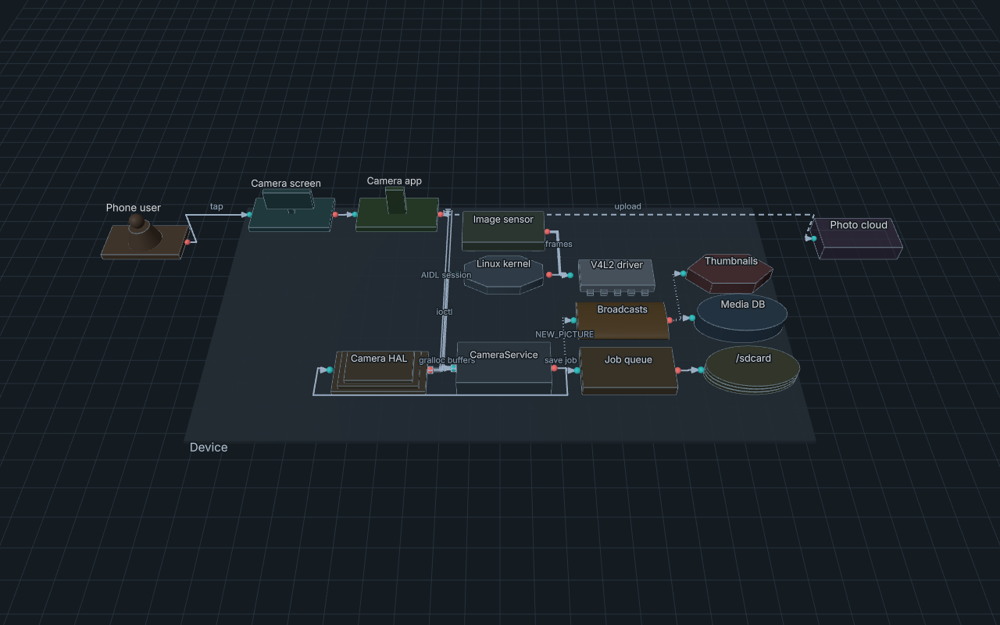

# Archi3D for VS Code

See your software architecture in 3D, next to the file you are editing.

Install: search for "Archi3D" in the Extensions view, or run `code --install-extension M-H-H.archi3d`.

## What it does

- Open the preview with the button in the editor title, with `Ctrl+K V` (`Cmd+K V` on Mac) or from
  the command palette ("Archi3D: Open 3D Preview to the Side").
- The preview updates while you type and the camera stays where you left it.
- Click a block to go to the line where it is defined. Double click to fly in.
- Errors and warnings show up in the editor and in the Problems panel. This works for `.arch3d`
  files and for Mermaid `architecture-beta` files (`.mmd`).
- Save the view as PNG ("Archi3D: Save 3D Preview as PNG...").
- Export one HTML file that works offline ("Archi3D: Export Standalone HTML...").
- Syntax colors for `.arch3d`.

Everything works offline. The layout engine and the font are inside the extension.

D2 files are not supported in the preview yet. You can import them in the Archi3D web app.

Examples (an Android app, the AOSP camera stack and more) and the guide for the language are in the
repo: https://github.com/Heydarchi/Archi3D

License: MIT. Licenses of the libraries inside: `THIRD_PARTY_NOTICES.md`.

